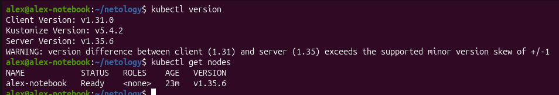
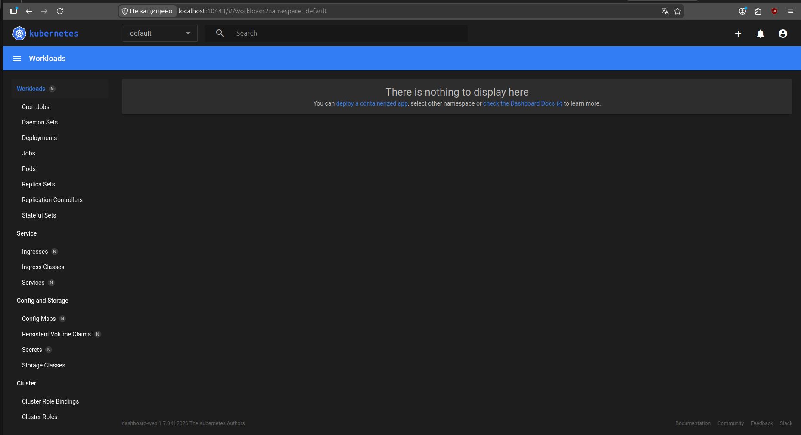

# Задание 1. Установка MicroK8S

1. Установка microk8s
```
sudo apt update
sudo apt install snapd
sudo snap install microk8s --classic
sudo usermod -a -G microk8s $USER
sudo chown -f -R $USER ~/.kube
```

2. Включение dashboard
```
microk8s enable dashboard
```

3. Для генерации сертификата в файле `/var/snap/microk8s/current/certs/csr.conf.template` указал внешний IP моего хоста:

```
...
[ alt_names ]
IP.3 = 192.168.1.187
...
```

Обновление сертификатов:
```
sudo microk8s refresh-certs --cert front-proxy-client.crt
```

# Задание 2. Установка и настройка локального kubectl

1. Установка kubectl:
```
curl -LO https://storage.googleapis.com/kubernetes-release/release/`curl -s https://storage.googleapis.com/kubernetes-release/release/stable.txt`/bin/linux/amd64/kubectl
chmod +x ./kubectl
sudo mv ./kubectl /usr/local/bin/kubectl
source <(kubectl completion bash)
echo "source <(kubectl completion bash)" >> ~/.bashrc
```

2. Создание конфига для подключения через kubectl:
```
microk8s config > ~/.kube/config
```




3. Для подключения к dashboard:
- создал токен доступа для пользователя `default` (в namespace `default`):
```
kubectl create token default
```
- настроил форвардинг портов из внешнего порта внутрь кластера (сервис `kubernetes-dashboard-kong-proxy`):
```
kubectl port-forward -n kubernetes-dashboard service/kubernetes-dashboard-kong-proxy 10443:443
```

Вход в dasboard по ранее полученному токену:

