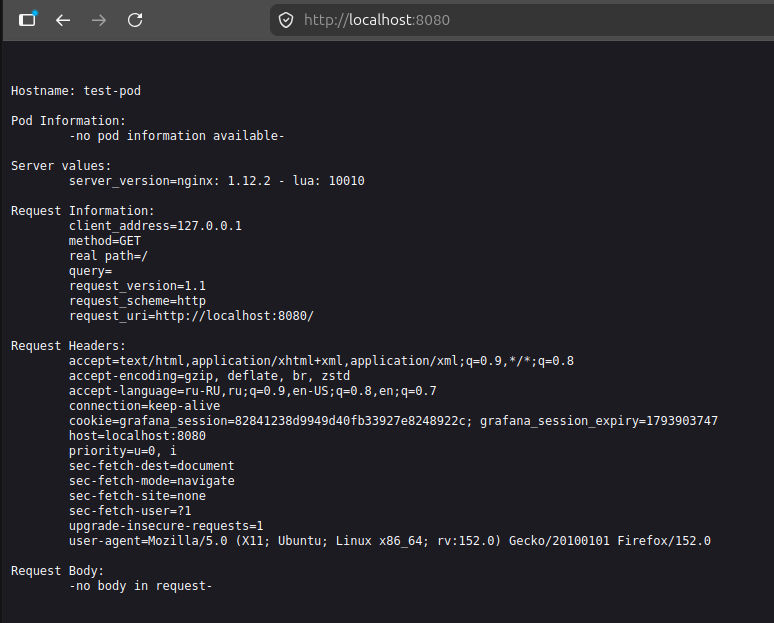
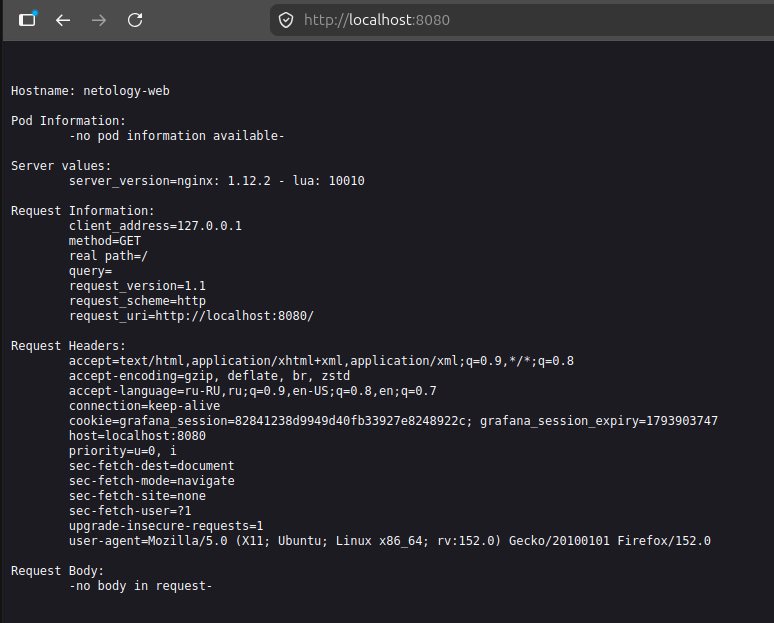

# Задание 1. Создание Pod

Создан тестовый pod:
```
apiVersion: v1
kind: Pod
metadata:
  name: test-pod
  labels:
    app: test
spec:
  containers:
    - name: test-container
      image: gcr.io/kubernetes-e2e-test-images/echoserver:2.2
      ports:
        - containerPort: 8080
```

Далее он был запущен, а также был проброшеy локальный порт к pod:
```
kubectl apply -f pod.yml
kubectl port-forward pods/test-pod 8080:8080
```

После обращения по `localhost:8080` можем получить информацию из Pod-a:




# Задание 2. Создать Service и подключить его к Pod

Был модифицирован [файл Pod-a](pod.yml), а также написан [файл сервиса](service.yml) для Pod-a:
```
apiVersion: v1
kind: Service
metadata:
  name: netology-svc
spec:
  selector:
    app: netology-web
  ports:
    - protocol: TCP
      port: 80
      targetPort: 8080
```

Применение манифестов и порт-форвардинг для созданного Service:
```
kubectl apply -f pod.yml
kubectl apply -f service.yml
kubectl port-forward svc/netology-svc 8080:80
```



