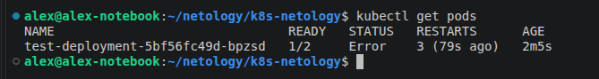
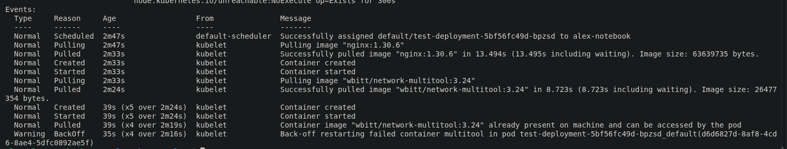
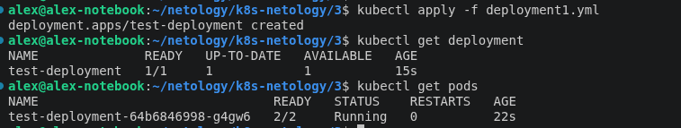
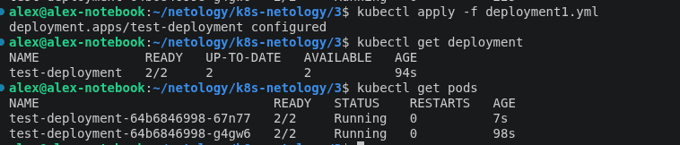
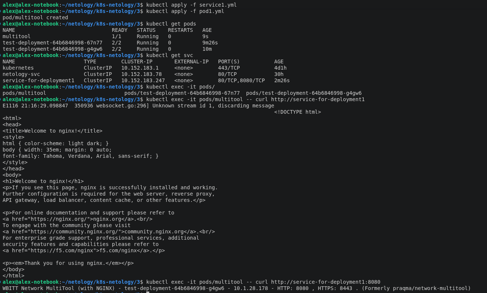
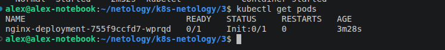
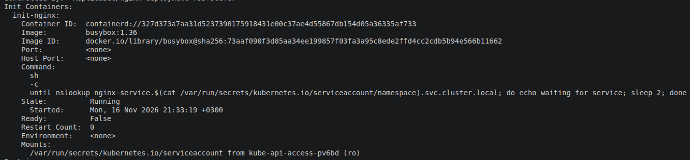
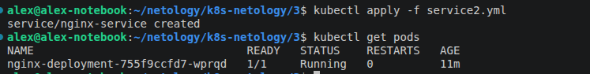

### Задание 1. Создать Deployment и обеспечить доступ к репликам приложения из другого Pod

Был создан тестовый [манифест](deployment1.yml).

Первоначальный вариант:
```yml
apiVersion: apps/v1
kind: Deployment
metadata:
  name: test-deployment
  labels:
    app: test
spec:
  replicas: 1
  selector:
    matchLabels:
      app1: nginx
      app2: multitool
  template:
    metadata:
      labels:
        app1: nginx
        app2: multitool
    spec:
      containers:
      - name: nginx
        image: nginx:1.30.6
        ports:
        - containerPort: 80
      - name: multitool
        image: wbitt/network-multitool:3.24
```

Запуск:
```
kubectl apply -f deployment1.yml
```

Проверка состояния выявила ошибку:




Выполнил команду `kubectl describe pod test-deployment-5bf56fc49d-bpzsd` с целью узнат, что не так, но лог оказался не слишком информативным:



Тогда я изучил документацию `multitools` и выяснил, что он, как и `nginx`, по умолчанию используют порт 80. Поэтому было принято решение явно указать порт для `multitools`:
```yml
apiVersion: apps/v1
kind: Deployment
metadata:
  name: test-deployment
  labels:
    app: test
spec:
  replicas: 1
  selector:
    matchLabels:
      app1: nginx
      app2: multitool
  template:
    metadata:
      labels:
        app1: nginx
        app2: multitool
    spec:
      containers:
      - name: nginx
        image: nginx:1.30.6
        ports:
        - containerPort: 80
      - name: multitool
        image: wbitt/network-multitool:3.24
        env:
        - name: HTTP_PORT
          value: "8080"
        - name: HTTPS_PORT
          value: "8443"
        ports:
        - containerPort: 8080
```

После исправления `deployment` и поды успешно запустились:



Далее число реплик было увеличено:
```yml
...
replicas: 2
...
```

Видим, что при повторном применении манифеста появился еще один под:



Далее были созданы [service](service1.yml) для обращения к созданым репликам подов, а также [pod multitool](pod1.yml) для тестирования соединений.

На скриншоте видим, что обращение из multitool успешно происходит по названию Service для созданных реплик, а также по указанию порта (80 - стандартный, поэтому не указываю):




### Задание 2. Создать Deployment и обеспечить старт основного контейнера при выполнении условий

[Был написан](deployment2.yml) `Deployment` для `nginx` с условием запуска **только при наличии** объекта `Service` в кластере k8s ([данный источник(https://kubernetes.io/docs/concepts/workloads/pods/init-containers/#init-containers-in-use)] помог для написания `init` контейнера):
```yml
apiVersion: apps/v1
kind: Deployment
metadata:
  name: nginx-deployment
spec:
  replicas: 1
  selector:
    matchLabels:
      app: nginx
  template:
    metadata:
      labels:
        app: nginx
    spec:
      initContainers:
      - name: init-nginx
        image: busybox:1.36
        command: ['sh', '-c', 'until nslookup nginx-service.$(cat /var/run/secrets/kubernetes.io/serviceaccount/namespace).svc.cluster.local; do echo waiting for service; sleep 2; done']
      containers:
      - name: nginx
        image: nginx:1.30.6
```

После запуска видим, что статус пода завис на Init:



Также можно посмотреть в `kubectl describe pod nginx-deployment-755f9ccfd7-wprqd` дополнительную информацию:



Создадим [`Service`](service2.yml) для данного `Deployment`:
```yml
apiVersion: v1
kind: Service
metadata:
  name: nginx-service
spec:
  selector:
    app: nginx
  ports:
    - name: nginx
      protocol: TCP
      port: 80
      targetPort: 80
    
```

После применения видим, что под успешно запустился:

