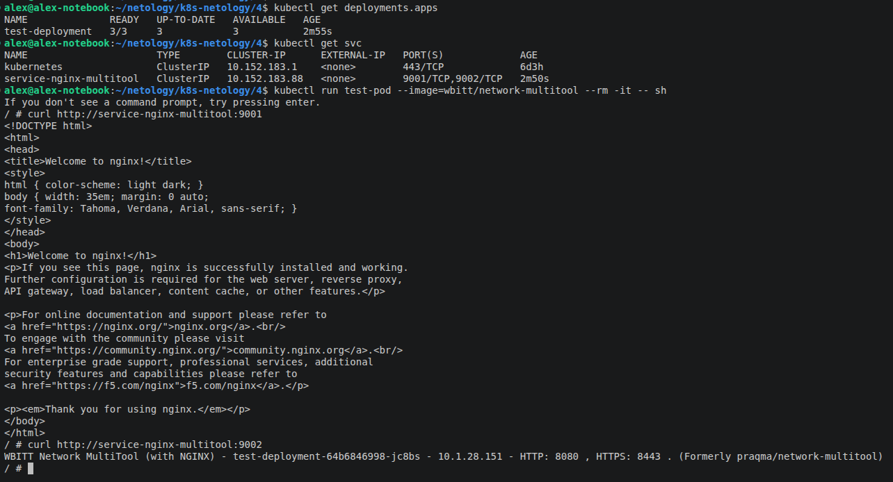
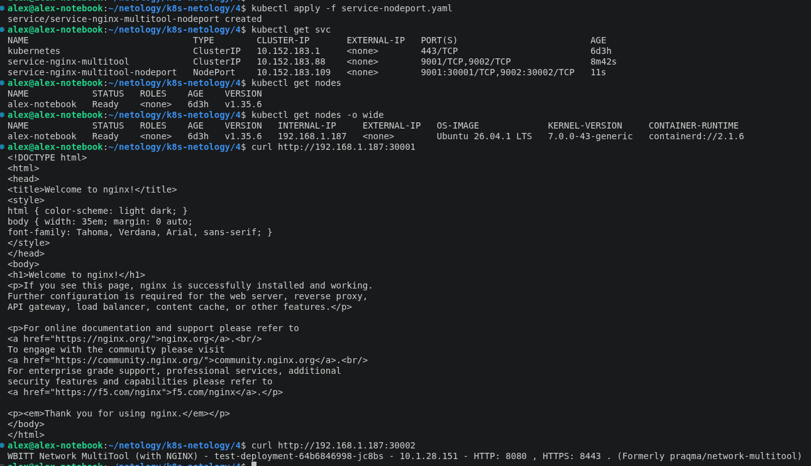
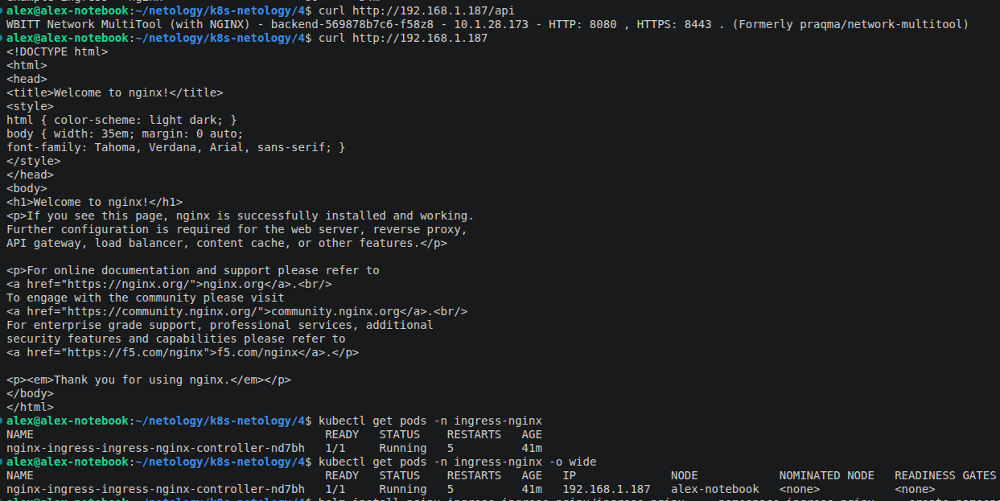

### Задание 1: Настройка Service (ClusterIP и NodePort)

Был реализован [Deployment](deployment-multi-container.yaml) с двумя контейнерами:
- nginx (порт 80)
- multitool (порт 8080)
- Количество реплик: 3

Также для созданного приложения был создан [Service](service-clusterip.yaml) с типом ClusterIP, который:
- открывает nginx на порту 9001
- открывает multitool на порту 9002

Проверка доступности внутри кластера:




Теперь создадим [Service с типом NodePort](service-nodeport.yaml), чтобы получить доступ к приложению за пределами кластера. По сути, NodePort - это надстройка над ClusterIP, т.к. у итогового объекта также будет внутренний IP внутри кластера, но помимо него на каждой ноде кластера будет прослушиваться специальный внешний порт (в диапазоне 30000 - 32767), отсюда и название.

Запустив его, мы можем обратиться к нашему Deployment извне кластера:




### **2. Ingress (для frontend и backend)**

Были созданы 2 Deployment ([frontend](deployment-frontend.yaml) и [backend](deployment-backend.yaml)) и 2 Service для них ([frontend](service-frontend.yaml) и [backend](service-backend.yaml))


Установка Ingress Controller (nginx):

```bash
sudo snap install helm --classic
helm repo add ingress-nginx https://kubernetes.github.io/ingress-nginx
helm repo update
kubectl create namespace ingress-nginx
helm install nginx-ingress ingress-nginx/ingress-nginx --namespace ingress-nginx --set controller.hostNetwork=true --set controller.kind=DaemonSet --set controller.service.type=ClusterIP
```

Теперь, создав [Ingress](ingress.yaml) с описанием правил, попробуем обратиться к приложению по IP хоста:




