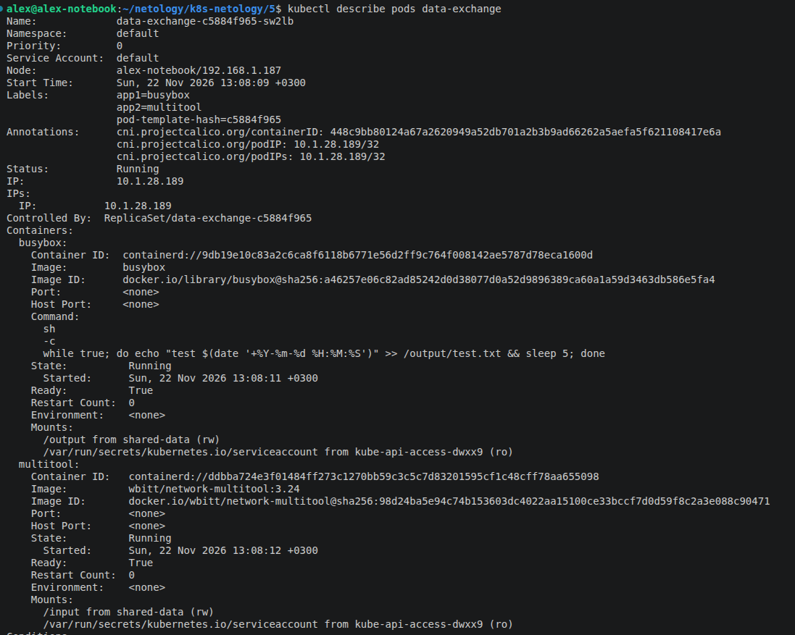
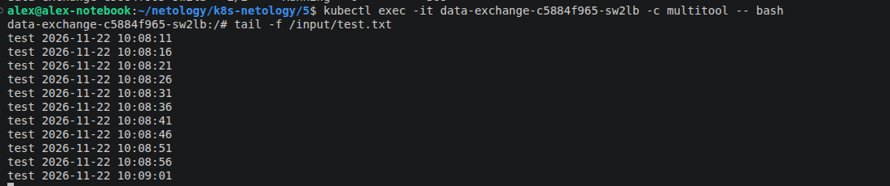
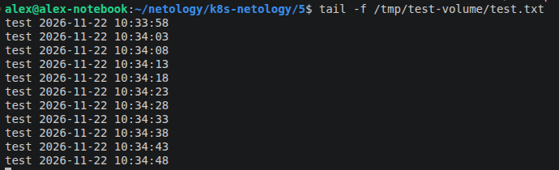
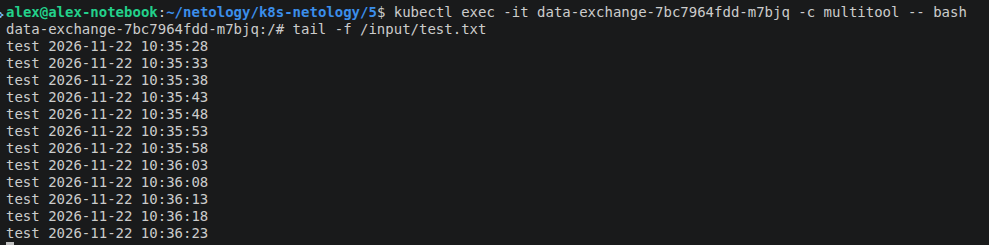
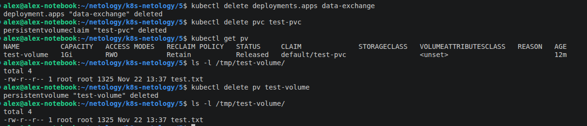
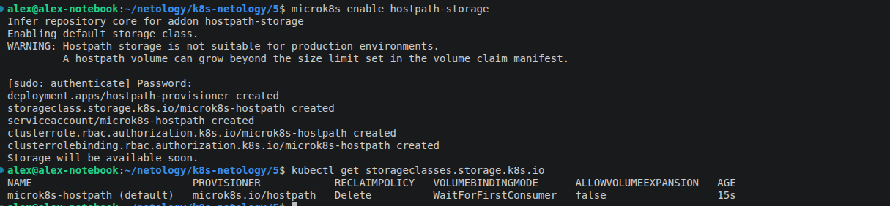
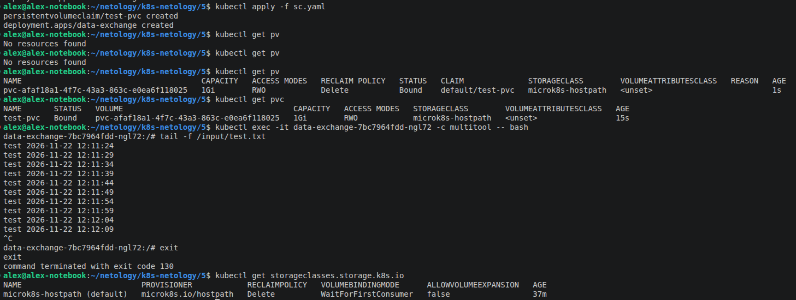

## Задание 1. Volume: обмен данными между контейнерами в поде

Создать Deployment приложения, состоящего из двух контейнеров, обменивающихся данными.

Был реализован [Deployment](containers-data-exchange.yaml) с двумя контейнерами для обмена данными через shared volume.

```yaml
    spec:
      containers:
      - name: busybox
        image: busybox
        command: ["sh", "-c", "while true; do echo \"test $(date '+%Y-%m-%d %H:%M:%S')\" >> /output/test.txt && sleep 5; done"]
        volumeMounts:
        - name: shared-data
          mountPath: /output
      - name: multitool
        image: wbitt/network-multitool:3.24
        volumeMounts:
        - name: shared-data
          mountPath: /input
      volumes:
      - name: shared-data
        emptyDir: {}
```

Создается volume `shared-data`, и далее он монтируется в оба контейнера, но в разные пути: 
- для `busybox` - по пути `/output` - записывает данные в файл `/output/test.txt`
- для `multitool` - по пути `/input` - читает данные из файла `/input/test.txt`

Описание пода:



Проверяем, что контейнер `multitool` получает данные через shared volume:




## Задание 2. PV, PVC

В рамках данного задания для хранения данных в кластере был создан отдельный объект `PersistentVolume`. Данный объект описывает сторонее хранилище, и как правило его помещают за пределы кластера (в данном задании мы используем `hostPath`, создавая том на той ноде, где запускается под). Его особенность - независимость от жизненного цикла подов и нодов кластера (кроме случая с `hostPath`).

Для того, чтобы под мог пользоваться `PersistentVolume`, необходимо создать другой объект - `PersistentVolumeClaim`. В нем необходимо указать:
- namespace PVC должен совпадать с namespace пода
- `accessModes` - режим доступа к тому
- `storage` - размер запрашиваемого тома

Далее controller manager выбирает PV согласно запрашиваемым требованиям в PVC. В данном тестовом примере мы явно указали `volumeName`, явно запрашивая ресурс конкретного PV.

Также в предыдущем `Deployment` был изменен тип volume: был `emptyDir`, стал `persistentVolumeClaim`. Разница в том, что `emptyDir` удалит содержимое volume при удалении пода, а `persistentVolumeClaim` оставит данные в PV.

Проделанная работа представлена в манифесте ['pv-pvc.yaml'](pv-pvc.yaml).

После применения манифеста можем увидеть, что в локальном хранилище создан файл:



Также данные доступны из контейнера `multitool`:



Удалив `Deployment` и `PersistentVolumeClaim`, видим, что сам `PersistentVolume` и файл в ФС сохранены. Это связано с тем, что `PersistentVolume` не зависит от жизненного цикла `Deployment` и `PersistentVolumeClaim`.

Удалив непосредственно `PersistentVolume`, также можем увидеть, что данные тома остались в ФС. Это объясняется параметром `persistentVolumeReclaimPolicy: Retain` - данная политика не удаляет ресурсы при удалении объекта `PersistentVolume`.




## Задание 3. StorageClass

Для работы с `StorageClass` был установлен дополнительный компонент в microk8s:



`StorageClass` - это объект, позволяющий автоматизировать создание `PersistentVolume`. Вместо ручного создания PV, в PVC можно указать `StorageClass` с необходимыми параметрами, а он в свою очередь создаст требуемый PV.

Предыдущий манифест был [обновлен](sc.yaml), теперь в PVC мы не ссылаемся на конкретный PV, а запрашиваем создание через `storageClassName: microk8s-hostpath`.

После применения манифеста:



Из скриншота видим, что новый PV был создан автоматически, а PVC успешно подключился к нему. Кроме того, контейнер `multitool` успешно прочитал данные.

