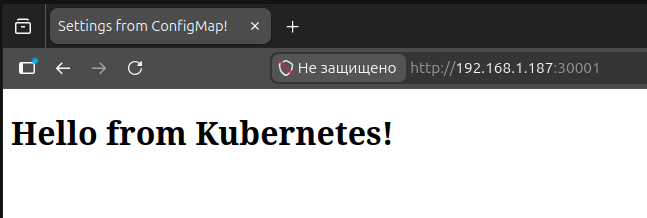
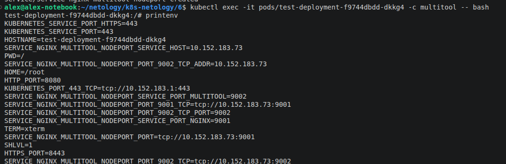
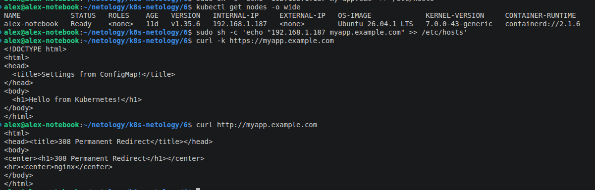
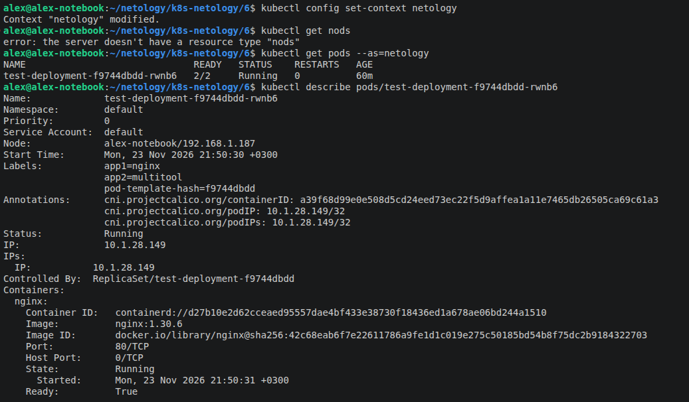

## **Задание 1: Работа с ConfigMaps**

Для [`Deployment`](deployment.yaml) был разработан [`ConfigMaps`](configmap-web.yaml). Благодаря нему была продемонстрирована возможность передачи конфигурации приложения двумя способами:
- переменными окружения
- монтирование полноценного файла (.html)

После запуска манифестов видим, что проброшенная .html страница отображается в браузере (через `NodePort`):



Также в контейнере multitool видим переданные переменные окружения:




## **Задание 2: Настройка HTTPS с Secrets**  

```bash
# Создание сертификата и ключа
openssl req -x509 -nodes -days 365 -newkey rsa:2048 -keyout tls.key -out tls.crt -subj "/CN=myapp.example.com"

# Кодирование серификата в base64
cat tls.crt | base64 -w 0

# Кодирование ключа в base64
cat tls.key | base64 -w 0
```

Далее был создан объект [`Secret`](secret-tls.yaml), где были указаны кодированные в base64 ключ и сертификат.

Также был создан манифест для [`Ingress`](ingress-tls.yaml), где ключевая настройка - это связка с ранее созданным `Secret` с типом `kubernetes.io/tls` для работы с TLS-сертификатом:
```yaml
...
  tls:
  - hosts:
    - myapp.example.com
    secretName: tls-secret
```

После применения конфигурации необходимо выполнить доп. настройку для работы доменного имени - внести запись о домене в /etc/hosts:



Видим, что приложение возвращает страницу по HTTPS, а по HTTP - нет, т.к. `Ingress Controller` автоматически создает редирект на HTTPS.


## **Задание 3: Настройка RBAC** 
Включение RBAC в microk8s:
```bash
microk8s enable rbac
```

Для создания сертификата пользователя необходимо скопировать файлы `ca.crt` и `ca.key` из каталога `/var/snap/microk8s/current/certs` узла microk8s.

Далее создаем сертификат пользователя и подписываем его сертификатом кластера:
```bash
openssl genrsa -out developer.key 2048
openssl req -new -key developer.key -out developer.csr -subj "/CN=netology"
openssl x509 -req -in developer.csr -CA ca.crt -CAkey ca.key -CAcreateserial -out developer.crt -days 365
```

После этого создаем в конфигурации k8s пользователя netology:
```bash
kubectl config set-credentials netology --client-certificate=developer.crt --client-key=developer.key --embed-certs=true
```

Создаем контекст:
```bash
kubectl config set-context netology --cluster=microk8s-cluster --user=netology
```

Были созданы объекты [`Role`](role-pod-reader.yaml) и [`RoleBinding`](rolebinding-developer.yaml). `Role` определяет роль внутри конкретного namespace (в данном случае в `default`) и права доступа для роли. `RoleBinding` позволяет связать роль и созданного ранее пользователя.

В итоге, применив манифесты и переключив контекст на пользователя netology, получилось продемонстрировать ограничение RBAC в K8s. Пользователь может видеть поды, их описание, но не может получить список нодов:




