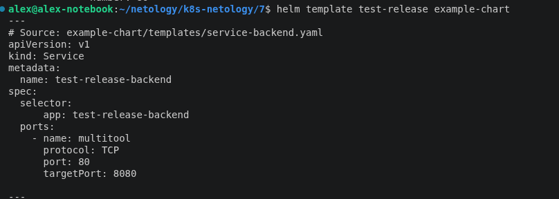
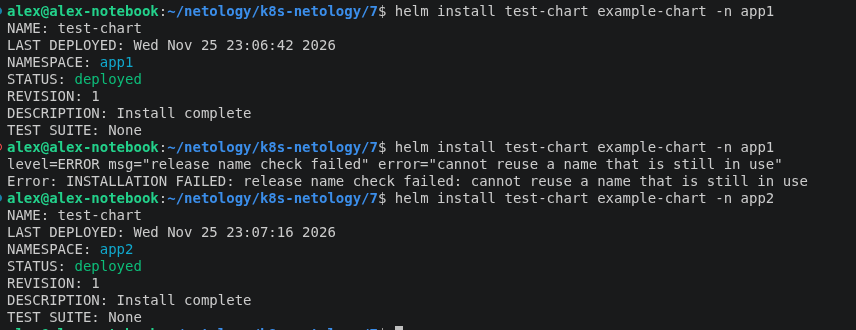

### Задание 1. Подготовить Helm-чарт для приложения

Создаем заготовку-шаблон Helm Chart для нашего приложения:
```bash
$ helm create example-chart
$ ls -la example-chart/
total 32
drwxr-xr-x 4 alex alex 4096 Nov 25 21:32 .
drwxrwxr-x 3 alex alex 4096 Nov 25 21:32 ..
-rw-r--r-- 1 alex alex  349 Nov 25 21:32 .helmignore
-rw-r--r-- 1 alex alex 1149 Nov 25 21:32 Chart.yaml
drwxr-xr-x 2 alex alex 4096 Nov 25 21:32 charts
drwxr-xr-x 3 alex alex 4096 Nov 25 21:32 templates
-rw-r--r-- 1 alex alex 5279 Nov 25 21:32 values.yaml
```

Созданный каталог `charts` нам не нужен, т.к. наш чарт не зависит от других чартов, поэтому удалим его. Также внутри каталога `templates/` были удалены все файлы.

Далее в файле [values.yaml](example-chart/values.yaml) были добавлены переменные, которые будут подставлены в шаблоны манифестов приложения k8s.

Разберем на примере backend:
```yaml
apiVersion: apps/v1
kind: Deployment
metadata:
  name: {{ .Release.Name }}-backend
  labels:
    app: {{ .Release.Name }}-backend
spec:
  replicas: {{ .Values.backend.replicas }}
  selector:
    matchLabels:
      app: {{ .Release.Name }}-backend
  template:
    metadata:
      labels:
        app: {{ .Release.Name }}-backend
    spec:
      containers:
        - name: multitool
          image: {{ .Values.backend.image }}:{{ .Values.backend.version }}
          env:
          - name: HTTP_PORT
            value: "{{ .Values.backend.httpPort }}"
          ports:
          - containerPort: {{ .Values.backend.httpPort }}
```

Здесь с помощью `.Values` подставляются значения из файла [values.yaml](example-chart/values.yaml), а `.Release.Name` - это зарезервированная переменная, имя релиза при установке чарта (`helm install ...`).


### Задание 2. Запустить две версии в разных неймспейсах

Протестировать подстановку переменных в чарт можно командой:
```bash
$ helm template <release name> example-chart 
```

Пример:




Далее было создано 2 тестовых namespace:
```bash
$ kubectl create namespace app1
$ kubectl create namespace app2
```

Попробуем установить наше приложение через Helm Chart.



При установке приложения с одним именем Release в один и тот же namespace получаем ошибку. Создать релиз в другом namespace получилось успешно.